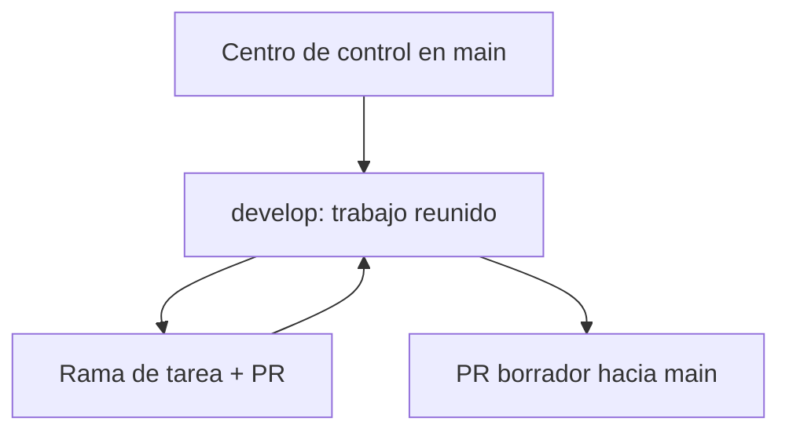

# Centro de control del proyecto

Este es el **punto de entrada para Dani y los agentes**, cualquiera que sea la carpeta del proyecto que esté abierta. Fecha de creación: 28/09/2026. Las referencias a ramas, PR y versiones cambian: comprobarlas al comenzar cada sesión.

## Cómo vamos a trabajar (guía para Dani)

| Paso | Lo que ves tú | Lo que queda guardado |
| --- | --- | --- |
| **1. Investigar** | Pantalla actual, dos referencias útiles y el problema concreto. | Enlace, fecha, captura y qué se observó o no se pudo comprobar. |
| **2. Decidir** | Una propuesta visual y un ejemplo real; eliges o corriges. | Una tarjeta con resultado esperado y, si es una regla duradera, `DECISIONS.md`. |
| **3. Construir** | La tarea pasa a «En desarrollo». | Rama propia desde `develop`, código y capturas de cada iteración. |
| **4. Enseñar y revisar** | Pruebas el cambio en escritorio y móvil; dices qué ajustar. | Antes/después, casos de error, pruebas, revisión independiente y PR. |
| **5. Integrar** | La tarjeta pasa a «Hecha» cuando la versión común funciona. | PR incorporado a `develop`, documento dueño y enlaces desde la tarjeta. |
| **6. Publicar** | Se decide por separado cuándo usarlo con clientes. | Checklist de seguridad y despliegue; «Hecha» no significa publicada. |

**Tú controlas las decisiones y el resultado visible.** Puedes cambiar de idea en cualquier paso: el agente actualiza la misma tarjeta, captura la nueva versión y anota por qué cambió. No se crean tareas duplicadas por cada iteración.

### Investigar una funcionalidad propia o de la competencia

La pregunta de investigación debe ser concreta (por ejemplo: «¿cuántos pasos hay desde elegir hora hasta recibir confirmación?»). Primero se recorre **nuestra web** y se registra la versión/ramal, escritorio y móvil, qué ocurrió realmente y dónde hay fricción. Después se revisan hasta dos referencias comparables: URL, fecha, pasos observados y captura o enlace. Se distinguen hechos, inferencias y aspectos inaccesibles (login, pago, disponibilidad). Si hay afirmaciones sobre precios, condiciones o funciones actuales, verificar la fuente actual antes de decidir. Nunca copiar una pantalla ni prometer funciones solo por una imagen.

El resultado cabe en una tarjeta: **problema → evidencia → propuesta de recorrido → decisión de Dani → prueba visible**. Para dinero, cancelaciones, permisos o datos de clientes, mostrar un ejemplo real y esperar la decisión antes de programar esas reglas. Si la investigación no requiere código, no crear una rama de producto solo para simular actividad.

### Responsables y prueba de cierre

- **Dani:** prioridad, reglas del negocio, elección de diseño y aceptación viendo la pantalla.
- **Agente implementador:** comprueba carpeta/rama/cambios locales; trabaja aislado desde la base vigente; mantiene tarjeta, código, pruebas y capturas juntos.
- **Agente revisor:** revisa el diff y los recorridos que cambian estado. Claude implementa y Codex revisa cuando ambos están disponibles; si Claude no está disponible, Codex puede implementar y se registra expresamente si falta revisión independiente. La herramienta no cuenta como revisor por sí sola.
- **Antes de marcar «Hecha»:** criterios acordados visibles, PR incorporado a `develop`, recorrido probado allí, evidencias accesibles desde otra copia y ningún pendiente bloqueante oculto. Para cambios de producto, `main` y la web publicada siguen siendo pasos separados.

La tarjeta Markdown y las capturas versionadas son la memoria compartida; Nimbalyst es la vista visual. Una copia abierta en el Mac **solo recibe cambios al actualizar su rama**. El detalle de Nimbalyst puede mostrar la ruta del archivo: ábrelo para ver las imágenes y enlaces; selecciona «All» para incluir las tareas hechas.

## El mapa en una pantalla

| Lugar | Qué contiene | Cuándo se actualiza |
| --- | --- | --- |
| `main` | Versión aceptada y copia compartida de este centro de control. | Tras revisión de documentos o integración de un conjunto de funciones. Confirmar antes si un merge dispara despliegue. |
| `develop` | Versión de trabajo común, creada desde el trabajo avanzado de integración. | Al reunir PR de tareas revisadas y al traer cambios compartidos de `main`. |
| Rama de tarea | Una función, investigación o corrección aislada. | Mientras la tarea está activa; PR hacia la base declarada. |
| Carpeta del Mac / clon / worktree | Una copia de una rama. No es fuente independiente de verdad. | Solo ve cambios de GitHub al actualizarla; puede contener trabajo local sin respaldar. |

**Relación real:** una rama es una versión del mismo repositorio, no una carpeta que haya que pegar con otra. Las decisiones y los archivos compartidos llegan a todas las copias mediante PR y actualización de Git. Nunca fusionar dos carpetas manualmente ni suponer que Nimbalyst sincroniza automáticamente dos worktrees.

## Dónde mirar y escribir cada cosa

| Si necesitas… | Abre / actualiza… |
| --- | --- |
| Saber qué hacer y dónde estamos | `ROADMAP.md` y el [plan maestro](PLAN_MAESTRO_PRODUCTO_Y_ENTREGA.md) |
| Recordar por qué decidimos una regla | `DECISIONS.md`; una decisión, fecha, ejemplo y efecto |
| Ver lo que está realmente integrado | `docs/estado-desarrollo.md` en `main`; `docs/estado-integracion.md` existe en `develop`. Confirmar siempre el PR y los commits de la rama consultada. |
| Ver pendientes en Nimbalyst | `nimbalyst-local/tracker/tarjetas.md` + `.nimbalyst/trackers/tarjeta.yaml` cuando ambos hayan sido incorporados a la rama |
| Saber cómo trabajar con agentes | `AGENTS.md`, `AI_WORKFLOW.md`, `.claude/commands/nueva-tarea.md` y `cerrar-tarea.md` |
| Cambiar reservas, datos o despliegue | `docs/BOOKING_FLOW.md`, `docs/DATABASE.md`, `docs/ANTES_DE_PUBLICAR.md` y código actual |

Evitar documentos paralelos para la misma regla. Una tarjeta apunta a su documento dueño, decisión, rama, PR, prueba y captura; el documento dueño explica la regla duradera. El tablero **muestra** el trabajo, pero GitHub guarda los Markdown y assets versionados.

## Evidencia visual de cada cambio

Para una tarea que modifica pantallas, crear `docs/evidencias/<id-de-tarjeta>/` en la **misma rama de la tarea**. Guardar allí `antes.png` y `despues.png` si aportan valor y un `resumen.md` corto con: objetivo, ruta de la pantalla, qué decidió Dani, commit/PR, comprobación en escritorio y móvil, y pendientes. Enlazar esa carpeta desde la tarjeta Nimbalyst y el PR. Si se itera, añadir una captura nueva con nombre descriptivo y actualizar el resumen; la decisión duradera también se registra en `DECISIONS.md` o el documento dueño. Las imágenes que usa la web van en `public/` junto al código que las referencia; las capturas de evidencia quedan en `docs/evidencias/` y no se publican en la interfaz.

Antes de confirmar imágenes, ocultar datos reales de clientes, claves, correos privados o pantallas de administración sensibles. Comprobar que los archivos elegidos se incluyen en el diff y en GitHub tras subir la rama. Una imagen enviada por chat o visible en Nimbalyst no se comparte automáticamente entre copias. Si no hay captura útil, describir la prueba en el resumen en vez de fabricar una.

## Prueba visual del tablero en Nimbalyst (29/09/2026)

Dani confirmó en una copia limpia de `develop` que la tarjeta de Mauri se recupera desde GitHub, se ve al seleccionar el filtro «All» y que, tras ponerla al inicio de `nimbalyst-local/tracker/tarjetas.md`, se muestra la vista previa de la captura. El detalle de la tarjeta muestra la ruta del Markdown: para consultar imágenes, enlaces y decisiones hay que **abrir ese archivo** en el editor. El cambio de estado de la tarjeta también quedó escrito en Markdown en la prueba anterior; cada copia local debe actualizar su rama para recibirlo.

**Regla práctica:** una tarjeta visual empieza con resultado, enlace antes/después y una vista previa relativa a un archivo versionado en `docs/evidencias/`. Abrir el archivo desde la tarjeta; en el tablero seleccionar «All» para incluir tareas hechas. Confirmar que la captura existe en la misma rama que el Markdown, y comprobar la vista tras abrir la copia del proyecto. El 29/09 Dani actualizó una copia limpia de `develop` por fast forward hasta `f031b25` y confirmó que la nota «Confirmado por Dani el 29/09» apareció en la misma tarjeta. Así quedó comprobado que una nota nueva versionada llega a otra copia tras actualizarla. No se ha probado edición simultánea de dos copias ni sincronización automática.

## Rutina sin perder conocimiento entre carpetas

1. **Al abrir:** comprobar rama y SHA, cambios locales sin guardar y últimos PR. Mostrar a Dani «integrado / para revisar / por decidir / siguiente».
2. **Al investigar:** anotar pregunta, fuentes y fecha, comportamiento real de nuestra web, alternativas y lo no comprobado. Dibujar solo el recorrido útil y registrar decisión en `DECISIONS.md`.
3. **Al desarrollar:** crear tarea desde `develop` actualizado; un agente implementa, otro revisa si el riesgo lo requiere. La tarjeta y el código viajan juntos por PR hacia `develop`.
4. **Al cambiar la forma de trabajar:** proponer documentos o comandos desde una rama de documentación hacia `main`. Una vez aceptados, incorporar `main` a `develop` revisando conflictos. Así llegan también a las siguientes ramas.
5. **Al preparar una versión aceptada:** comparar `develop` con `main` en [PR borrador #3](https://github.com/danielruizpadel-ux/trainer-booking-platform/pull/3), comprobar riesgos reales, y solo entonces integrar. Esto también lleva a `main` las decisiones nuevas nacidas en `develop`.
6. **Al abrir otra carpeta:** traer la rama vigente del repositorio; comprobar el contenido y las imágenes en esa carpeta antes de concluir que se perdió trabajo.

**Regla de reciprocidad:** cambios compartidos de protocolo viajan `main → develop`; trabajo de producto validado viaja `develop → main`. Ambos movimientos son PR o merges revisados; no hay sincronización mágica por abrir una carpeta. Las copias locales se actualizan después. Mientras un PR está abierto, enlazarlo como «propuesto» y no describir su contenido como integrado.

## Límite observado del commit en Nimbalyst

En la prueba de la reserva de Mauri, el chat de Nimbalyst estaba abierto en el clon `test/nimbalyst-estado-compartido`, mientras el código se editó en el worktree aislado `/Users/dani/worktrees/mauri-reserva-facil`. La vista de cambios mostró archivos del segundo, pero el botón de commit actuaba solo sobre la carpeta abierta y pidió cambiar de proyecto. **Regla operativa:** el agente confirma ruta, rama, base, diff y archivos sin seguimiento del worktree dueño; usa Git desde esa ruta concreta para añadir solo los archivos de la tarea, confirmar y subir su rama, o abre ese worktree en Nimbalyst si Dani prefiere la interfaz. No hacer commit del proyecto que está abierto solo porque sea el que muestra el chat. Tras subir, comprobar archivos y commit del PR en GitHub y enlazarlo desde la tarjeta. Esta limitación queda pendiente de reevaluar antes de adoptar Nimbalyst como interfaz única.

## Aprendizaje de la primera revisión de producto

La revisión del PR #5 detectó un caso que no mostraban las capturas iniciales: al cambiar de semana con las flechas, la cabecera puede mostrar fechas nuevas mientras el día enfocado y las horas pertenecen a la semana anterior. **Regla del protocolo:** además de comparar antes/después en escritorio y móvil, recorrer las transiciones que cambian estado (flechas, minicalendario, duración, selección de varias clases y regreso). La evidencia debe decir qué se comprobó y qué quedó pendiente. Un error encontrado vuelve a la misma rama de tarea y se revisa de nuevo en el mismo PR antes de integrar.

## Estado de implantación

- `develop` ya existe, sin despliegue ni cambios en `main` por crearlo.
- Este PR de documentación reúne el tablero Markdown y su configuración con el protocolo para que ambos se acepten juntos en `main`. El [PR #2](https://github.com/danielruizpadel-ux/trainer-booking-platform/pull/2) fue la prueba aislada: un clon nuevo mostró INP.2 y sus etiquetas; todas las columnas y los assets aún necesitan prueba.
- [PR #5](https://github.com/danielruizpadel-ux/trainer-booking-platform/pull/5) incorporó la reserva fácil de Mauri a `develop` (merge `6d179340`, 29/09). Se probó la navegación semanal en el Mac; la reserva real sigue sin probarse.
- [PR borrador #3](https://github.com/danielruizpadel-ux/trainer-booking-platform/pull/3) conecta `develop` con `main`; no implica aceptación ni publicación.
- El centro de control y el tablero están en `main` ([PR #4](https://github.com/danielruizpadel-ux/trainer-booking-platform/pull/4), `424828f`) y en `develop` ([PR #6](https://github.com/danielruizpadel-ux/trainer-booking-platform/pull/6), `3771c24`). Las ramas se conectan mediante un merge revisado. Dani confirmó que el repositorio no está conectado a una publicación automática; esta confirmación no sustituye la checklist de `docs/ANTES_DE_PUBLICAR.md` para futuros despliegues. El producto integrado en `develop` sigue separado del `main` actual hasta revisar el PR #3.
