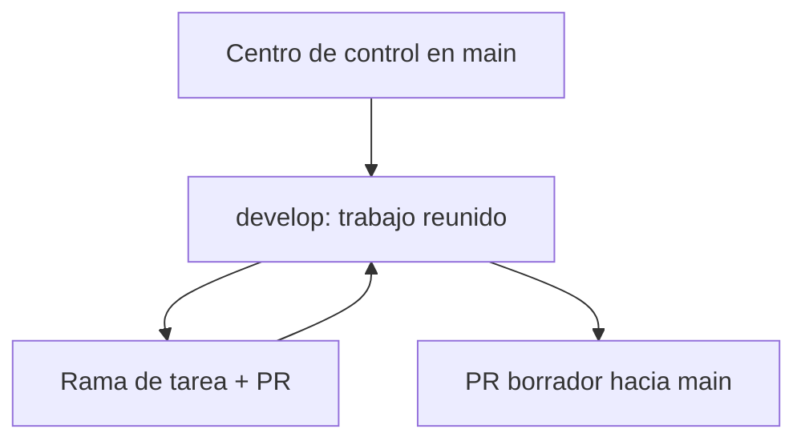

# Centro de control del proyecto

Este es el **punto de entrada para Dani y los agentes**, cualquiera que sea la carpeta del proyecto que esté abierta. Fecha de creación: 28/09/2026. Las referencias a ramas, PR y versiones cambian: comprobarlas al comenzar cada sesión.

## El mapa en una pantalla

| Lugar | Qué contiene | Cuándo se actualiza |
| --- | --- | --- |
| `main` | Versión aceptada y copia compartida de este centro de control. | Tras revisión de documentos o integración de un conjunto de funciones. Confirmar antes si un merge dispara despliegue. |
| `develop` | Versión de trabajo común, creada desde el trabajo avanzado de integración. | Al reunir PR de tareas revisadas y al traer cambios compartidos de `main`. |
| Rama de tarea | Una función, investigación o corrección aislada. | Mientras la tarea está activa; PR hacia la base declarada. |
| Carpeta del Mac / clon / worktree | Una copia de una rama. No es fuente independiente de verdad. | Solo ve cambios de GitHub al actualizarla; puede contener trabajo local sin respaldar. |

**Relación real:** una rama es una versión del mismo repositorio, no una carpeta que haya que pegar con otra. Las decisiones y los archivos compartidos llegan a todas las copias mediante PR y actualización de Git. Nunca fusionar dos carpetas manualmente ni suponer que Nimbalyst sincroniza automáticamente dos worktrees.

## Dónde mirar y escribir cada cosa

| Si necesitas… | Abre / actualiza… |
| --- | --- |
| Saber qué hacer y dónde estamos | `ROADMAP.md` y el [plan maestro](PLAN_MAESTRO_PRODUCTO_Y_ENTREGA.md) |
| Recordar por qué decidimos una regla | `DECISIONS.md`; una decisión, fecha, ejemplo y efecto |
| Ver lo que está realmente integrado | `docs/estado-integracion.md` y PR/commits de la rama consultada |
| Ver pendientes en Nimbalyst | `nimbalyst-local/tracker/tarjetas.md` + `.nimbalyst/trackers/tarjeta.yaml` cuando ambos hayan sido incorporados a la rama |
| Saber cómo trabajar con agentes | `AGENTS.md`, `AI_WORKFLOW.md`, `.claude/commands/nueva-tarea.md` y `cerrar-tarea.md` |
| Cambiar reservas, datos o despliegue | `docs/BOOKING_FLOW.md`, `docs/DATABASE.md`, `docs/ANTES_DE_PUBLICAR.md` y código actual |

Evitar documentos paralelos para la misma regla. Una tarjeta apunta a su documento dueño, decisión, rama, PR, prueba y captura; el documento dueño explica la regla duradera. El tablero **muestra** el trabajo, pero GitHub guarda los Markdown y assets versionados.

## Rutina sin perder conocimiento entre carpetas

1. **Al abrir:** comprobar rama y SHA, cambios locales sin guardar y últimos PR. Mostrar a Dani «integrado / para revisar / por decidir / siguiente».
2. **Al investigar:** anotar pregunta, fuentes y fecha, comportamiento real de nuestra web, alternativas y lo no comprobado. Dibujar solo el recorrido útil y registrar decisión en `DECISIONS.md`.
3. **Al desarrollar:** crear tarea desde `develop` actualizado; un agente implementa, otro revisa si el riesgo lo requiere. La tarjeta y el código viajan juntos por PR hacia `develop`.
4. **Al cambiar la forma de trabajar:** proponer documentos o comandos desde una rama de documentación hacia `main`. Una vez aceptados, incorporar `main` a `develop` revisando conflictos. Así llegan también a las siguientes ramas.
5. **Al preparar una versión aceptada:** comparar `develop` con `main` en [PR borrador #3](https://github.com/danielruizpadel-ux/trainer-booking-platform/pull/3), comprobar riesgos reales, y solo entonces integrar. Esto también lleva a `main` las decisiones nuevas nacidas en `develop`.
6. **Al abrir otra carpeta:** traer la rama vigente del repositorio; comprobar el contenido y las imágenes en esa carpeta antes de concluir que se perdió trabajo.

**Regla de reciprocidad:** cambios compartidos de protocolo viajan `main → develop`; trabajo de producto validado viaja `develop → main`. Ambos movimientos son PR o merges revisados; no hay sincronización mágica por abrir una carpeta. Las copias locales se actualizan después. Mientras un PR está abierto, enlazarlo como «propuesto» y no describir su contenido como integrado.

## Estado de implantación

- `develop` ya existe, sin despliegue ni cambios en `main` por crearlo.
- [PR #2](https://github.com/danielruizpadel-ux/trainer-booking-platform/pull/2) propone el tablero a `develop`; un clon nuevo de esa rama mostró INP.2 y sus etiquetas, pero el comportamiento de todas las columnas y los assets aún necesita prueba.
- [PR borrador #3](https://github.com/danielruizpadel-ux/trainer-booking-platform/pull/3) conecta `develop` con `main`; no implica aceptación ni publicación.
- Este centro de control es una **propuesta de documentación** hasta integrarlo en `main` y traerlo a `develop`. El plan maestro distingue lo observado, las propuestas y lo pendiente de Dani.
