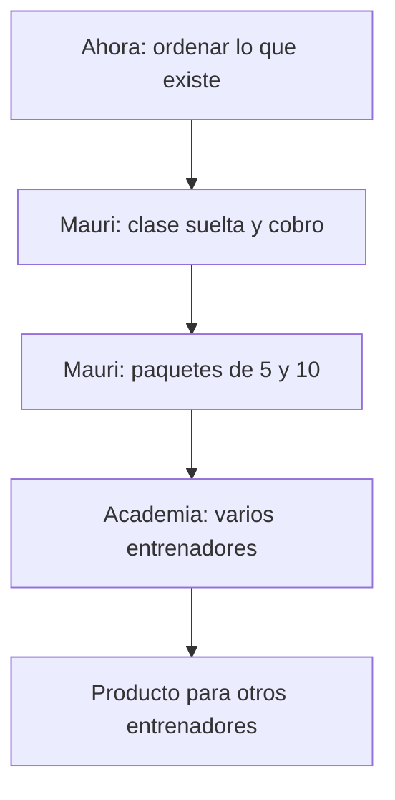

# Plan maestro: reservas para entrenadores y academia

**Fecha:** 28/09/2026 · **Estado:** plan de trabajo, pendiente de validación de decisiones abiertas.  
**Rama de referencia:** `emdash/integracion-programa` (`7e6357e` al redactar). `main` está en `4845640`, 47 commits detrás. Comprobar de nuevo las referencias antes de implementar.

## Tu mapa del proyecto

**Objetivo inmediato:** que Mauri pueda usar la aplicación para cobrar y gestionar clases privadas sin perder reservas, dinero ni información de clientes. Después la adaptamos para la academia y para ofrecerla a otros entrenadores.



| ¿Dónde estamos? | En palabras sencillas |
| --- | --- |
| **Ya existe** | Una base de reservas, cuentas, precios y panel. Hay trabajo avanzado en una rama de integración, aún sin reunir en `main`. |
| **Ahora toca** | Poner a salvo y ordenar ramas, fotos y tareas; comprobar qué funciona; decidir las reglas de cobro y cancelación. |
| **Luego construimos** | Primero el uso real de Mauri; después sus paquetes, la operación de academia y finalmente el producto comercial. |
| **Todavía no está listo** | Abrirlo a clientes reales o dar por hecho que los pagos online y el programa de 10 sesiones funcionan. |

### Cómo trabajaremos contigo

1. **Tú decides cómo debe funcionar el negocio.** Te enseñaré una opción concreta con un ejemplo de cliente; podrás responder en lenguaje normal.
2. **Yo traduzco esa decisión en una tarea pequeña.** Cada tarea tendrá una frase de objetivo, una captura o pantalla si hace falta, y un resultado visible. El detalle técnico queda para el desarrollador.
3. **Se construye y se enseña antes de continuar.** La tarea se revisa y se incorpora a la versión de trabajo; el siguiente paso empieza desde esa versión. Te diré claramente: *hecho*, *en revisión* o *pendiente*.

**Lo único que necesito decidir contigo primero:** ¿el primer uso real será solo Mauri, o necesitas que desde el primer día dos entrenadores de la academia trabajen con los mismos clientes? Si no lo tienes claro, empezamos por Mauri y diseñamos las cuentas para añadir el segundo entrenador después.

> A partir de aquí está el detalle de negocio y desarrollo para quien ejecute las tareas. Puedes usar solo el mapa anterior para seguir el progreso.

## 1. Norte de producto

Una sola plataforma de reservas con un núcleo compartido: identidad del jugador, entrenador responsable, oferta y precios, disponibilidad, solicitud y confirmación, paquetes/créditos, cancelación, cobros y comunicaciones. Dos usos sobre ese núcleo:

| Carril | Objetivo próximo | Regla de alcance |
| --- | --- | --- |
| Academia / piloto Mauri | Operar clases privadas y paquetes de 5/10 con cuenta de jugador, pista incluida, confirmación manual, efectivo, deuda visible y control desde el panel. | Es la primera experiencia real; comprobar las reglas con reservas reales controladas antes de generalizarlas. |
| Producto para entrenadores | Convertir esas funciones en ajustes seguros por entrenador y, más adelante, en un servicio que se pueda incorporar y vender a otros entrenadores. | Preparar separación de datos y configuraciones sin construir ahora alta autónoma, facturación SaaS ni pagos multicuenta. |

**Academia no equivale a un entrenador.** Si varios entrenadores comparten clientes, pistas, agenda o cuenta de cobro, se necesitará una entidad y permisos de academia definidos. No inferir que basta con asignar cada reserva a Mauri. Decidir titular del cliente, visibilidad entre entrenadores y destinatario del dinero antes de implementar esta capa. En V1, el piloto usa a Mauri; la academia completa se diseña con casos concretos.

El Player Development Plan de 10 sesiones, `/programa`, permanece como prototipo separado; no integrarlo en los paquetes de 5/10 sin una especificación propia.

## 2. Situación comprobada y límites de evidencia

- Comparación de GitHub a 28/09: integración está 47 commits por delante de `main` y no había PR abiertos. Las ramas `backup/clientes-wip` y `backup/ui-improvement-docs` contienen trabajo aislado; no se ha comprobado el estado de worktrees locales no subidos.
- En integración hay cuenta de jugador, checkout, precios por entrenador, solicitudes de reserva, panel, paquetes internos y migraciones hasta 021. `/programa` usa datos de ejemplo. La sección Clients está en `backup/clientes-wip`, no en integración.
- El PDF `ESTADO_DESARROLLO_Y_PROXIMAS_FASES_2026-09-27.pdf` comunica que 011–021 se aplicaron y que hubo un recorrido local satisfactorio. Tratarlo como resultado informado en ese momento; verificar el esquema vigente y su historial de aplicación antes de nuevas migraciones.
- `ROADMAP.md`, `docs/PLAN_PAQUETES_Y_CALENDARIO.md`, `docs/estado-desarrollo.md`, `README.md` y algunas notas en `CLAUDE.md` conservan frases anteriores a las últimas migraciones. En caso de conflicto, inspeccionar código, commit y base real; registrar la corrección en el documento dueño. No repetir migraciones ni limpieza de datos por el estado de una nota.
- El orquestador V1 existe, pero requiere simultáneamente Claude, Codex, Bothread y un árbol limpio. Un límite de Claude termina la ejecución en FAILED; no hay sustitución automática. Sus registros en `orchestrator/runs/` están ignorados por Git. Puede servir para una tarea acotada cuando estén disponibles ambos, pero no gobierna ramas, roadmap, fotos, decisiones ni merges.

## 3. Contrato funcional ya decidido para el piloto

Mantener las decisiones de producto del PDF, páginas 3–5, como entrada. En síntesis: cuenta obligatoria para contratar/reservar; clases sueltas y packs de 5/10; pista siempre incluida; precios configurables por Mauri y congelados en cada contratación; jugadores y duración fijos dentro del pack; reservas parciales; confirmación tras comprobar la pista; efectivo en la clase suelta y pago completo del pack el primer día; seis meses desde la primera clase impartida; fin automático de clases confirmadas con corrección manual; plazo inicial de cancelación 24 h configurable; cargo pendiente visible y aviso discreto sin bloquear nuevas reservas; acciones auditables para pago, asistencia, devolución de crédito y retirada de cargo.

**No confundir:** estado de reserva, asistencia, crédito del paquete y obligación de pago son dimensiones distintas. Una sesión de paquete no crea un nuevo cargo por el total. Guardar importe, momento, actor y motivo de cada ajuste; `wallet` en esta etapa es saldo e historial de deuda, no dinero custodiado.

**Decisiones todavía abiertas que bloquean código concreto:**
1. Importe de una cancelación tardía de clase suelta y tratamiento de no presentación.
2. Combinaciones permitidas de número de jugadores × duración y su precio; posible diferencia entre Mauri y academia.
3. Qué pasa con vencimiento y créditos cuando se corrige la primera clase marcada impartida.
4. Si cambios del plazo de cancelación rigen solo para reservas nuevas (recomendación: congelar la regla por reserva).
5. En academia: propiedad de cliente, permisos de entrenadores y cobro a una sola cuenta de la academia.

## 4. Entregas ordenadas

| Hito | Resultado demostrable | Prueba de salida |
| --- | --- | --- |
| 0. Inventario y base fiable | Comparar GitHub con worktrees locales; preservar cambios no subidos, fotos y referencias; revisar `backup/clientes-wip`; comprobar migraciones vigentes y riesgos de despliegue. Abrir tareas con dueño y dependencia. | Tabla de ramas/commits/rutas de assets, estado de BD verificado, cero trabajo sin respaldo identificado. |
| 1. Diseño de contratos | Diagramar reserva suelta y pack, relación jugador-entrenador-academia, estados, pagos y créditos. Cerrar las decisiones que afectan al esquema. | Criterios de aceptación y transiciones documentados, ejemplos de cancelación temprana/tardía y corrección. |
| 2. Piloto de reserva suelta | Cuenta exigida en UI y API; ficha Clients mínima y aislada; solicitud, confirmación de pista, pago en efectivo, cancelación y deuda trazable. | Dos usuarios y entrenadores de prueba; reservas repetidas, dos solicitudes concurrentes, acceso cruzado denegado, importes históricos estables. |
| 3. Packs 5/10 | Compra/contratación desde cuenta, créditos reservados sin doble uso, agenda parcial, validez, asistencia, cobro único y correcciones. | Reservar algunas fechas y luego otras; falta de pista libera crédito; cancelar dentro/fuera; vencer; reintentar sin duplicar. |
| 4. Comunicación y acabado | Emails de solicitud/confirmación/cambio/cancelación, WhatsApp manual, inglés, móvil, precios y botones reales. | Mensajes describen el estado verdadero; no se promete pista hasta confirmación; prueba en móvil. |
| 5. Academia operativa | Definir entidad academia, varios entrenadores y permisos, asignación de reservas y cobro a cuenta única si el piloto lo exige. | Casos reales de un jugador con dos entrenadores y roles separados; pruebas de aislamiento. |
| 6. SaaS entrenadores | Alta, configuración, soporte, planes y modelo comercial, cobros por entrenador según país/proveedor. | Piloto externo y métricas de uso antes de implementar facturación y onboarding autoservicio. |

Los hitos 2–4 pueden incluir campos configurables por entrenador, con valores iniciales para Mauri. No construir un editor libre de estados, saldos o permisos. El hito 5 puede adelantarse en alcance reducido si la academia lo necesita antes que los packs; registrar el cambio de dependencia.

**Puerta de publicación:** usar `docs/ANTES_DE_PUBLICAR.md`, resolver bloqueantes vigentes, pasar build/type-check y pruebas relevantes, comprobar esquema y entorno publicado, revisar experiencia con Mauri. No asumir que un merge en `main` despliega ni que está desconectado de hosting: verificar automatizaciones primero.

## 5. Forma de trabajar desde hoy

### Fuente de verdad y tareas

- `main` es la versión aceptada; mientras esté atrasada, `emdash/integracion-programa` es la base de trabajo explícita, sin llamarla producción. Cada tarea enlaza **rama base + SHA**, dueño, archivos o zona, dependencia, decisiones abiertas, criterios de aceptación, pruebas y estado: `planned → in progress → review → integrated`.
- Una tarea = una rama/worktree desde la base vigente. Antes de empezar: `git status --short --branch`, `git log -1 --oneline`, `git worktree list`, `git branch -vv`, `git fetch` cuando haya conexión. No crear otro worktree hasta inventariar los existentes. No reusar una rama compartida en dos worktrees ni trabajar el mismo archivo a la vez sin coordinación.
- Integrar en orden de dependencias con PR corto hacia la rama base declarada. Revisar `git diff`, pruebas y cambios de base; actualizar/rebasar de forma segura cuando cambie la base; resolver conflictos en la rama de la tarea. Después del merge, actualizar tareas y documentos dueño. No borrar ramas o worktrees que contengan cambios sin integrar o archivos sin respaldo.
- Documentar decisiones duraderas en `DECISIONS.md`; ordenar hitos en `ROADMAP.md`; estado de integración en `docs/estado-integracion.md`. Este documento une estrategia y procedimiento, no reemplaza documentación de BD, reservas o seguridad. No marcar una tarea como hecha porque una IA lo dijo.
- Durante el límite de Claude, **Codex implementa una tarea delimitada y revisa diff y pruebas**; para cambios de mayor riesgo, realizar revisión separada antes del merge. Cuando vuelva Claude: Claude puede implementar; Codex revisa independientemente. El orquestador V1 solo se usa donde sus requisitos se cumplen, sin presentarlo como control de todo el proyecto.

### Fotos y otros archivos

- Diferenciar **asset del producto** de referencia de diseño. Si la app debe renderizar una foto, debe estar en una ruta versionada del repositorio y referenciada desde el código (ejemplo actual `public/trainers/mauri/hero.jpg`), con permiso de uso y tamaño razonable. Añadirla a la misma rama/PR que su UI; comprobar que aparece en `git status`, `git ls-files` y en GitHub después del push. Si está ignorada, fuera de Git, solo en un chat o solo en un worktree, el siguiente worktree no la tendrá.
- Referencias visuales no publicadas: guardar original y enlace estable fuera del repo o en un área de referencias acordada; registrar en la tarea ubicación, fecha, autorización y qué se debe reproducir. Evitar subir fotos personales de clientes o credenciales al repositorio.
- Antes de cerrar una rama con cambios visuales, comprobar render de las imágenes en la rama integrada y en móvil; no trasladar imágenes copiando una carpeta local sin comprobar su seguimiento en Git.

### Plantilla mínima de tarea

```text
Objetivo:
Carril e hito:
Base: rama @ SHA
Dueño/agente:
Archivos o área reservados:
Dependencias y decisiones abiertas:
Comportamiento esperado (jugador / entrenador / admin):
Datos, permisos y casos de error:
Assets y referencia:
Pruebas y captura de evidencia:
PR/commit de integración:
```

## 6. Programa visual y protocolo de desarrollo

**Propósito:** Dani controla prioridades, reglas de negocio y diseño sin tener que leer Git. Los agentes ejecutan tareas delimitadas y dejan una prueba visible. El tablero vive en archivos del proyecto y se respalda en GitHub. Nimbalyst es el candidato a interfaz visual; la prueba inicial debe demostrar que tareas, imágenes y decisiones se conservan al abrir el proyecto en otra copia. Emdash puede seguir disponible hasta decidir el cambio.

### Una sola vista de control

Mantener un tablero con cinco estados: **Idea → Por decidir → Lista → En desarrollo → Para revisar → Hecha**. Tres líneas de producto: **Mauri**, **Academia**, **Entrenadores**. Cada tarjeta muestra un título en lenguaje normal, el resultado visible, prioridad, responsable, estado y enlace a las capturas y al cambio integrado. Limitar el trabajo simultáneo: una tarea que afecte reservas o base de datos cada vez; tareas visuales independientes solo si no comparten archivos.

Guardar tarjetas importantes como Markdown versionado en el repositorio. Confirmar en la prueba de Nimbalyst si el tipo elegido es un archivo rastreado por Git: sus elementos nativos de base local no quedan respaldados solo por verse en el tablero. Las imágenes insertadas en documentos deben estar versionadas junto al documento o enlazadas a un lugar estable, con revisión de privacidad.

### Una función, siete pasos

| Paso | Quién | Qué queda visible para Dani | Puerta para avanzar |
| --- | --- | --- | --- |
| 1. Idea | Dani + ChatGPT | Qué problema resuelve y para quién; ejemplo real. | Dani confirma el resultado deseado. |
| 2. Decisión | ChatGPT | Opciones de negocio, recomendación, regla elegida y asuntos abiertos. | Reglas que cambian datos/dinero cerradas. |
| 3. Diseño | Agente de análisis, sin editar producto | Recorrido del cliente y entrenador, boceto o diagrama pequeño, criterios de aceptación. | Dani entiende y valida el recorrido. |
| 4. Tarea | ChatGPT / coordinador | Tarjeta lista con base y dependencia; un agente nombrado para implementar y otro para revisar cuando proceda. | Worktree correcto y archivos de referencia respaldados. |
| 5. Construcción | Codex mientras Claude esté limitado; Claude o Codex después según tarea | Pantalla o comportamiento funcionando, enlace al cambio, pruebas resumidas. | Diff acotado y sin archivos ajenos. |
| 6. Revisión | Agente distinto si el riesgo lo amerita + Dani para experiencia | Captura o demo, escenarios de error, resultado de pruebas y pendientes. | Correcciones hechas y revisión aceptada. |
| 7. Integración | Responsable de integración | Tarjeta Hecha con PR/commit y versión de trabajo donde se puede ver. | Cambio incorporado a la rama base y documentación de decisión actualizada. |

**Definición de Hecha:** no basta con que el agente termine ni con que exista una rama. Tiene que estar integrado en la rama base declarada, tener pruebas apropiadas y una evidencia visual/funcional que Dani pueda evaluar. Una migración escrita no significa aplicada; una pantalla demo no significa venta o cobro real.

### Plantillas breves para agentes

**Analizar (sin código):** “Lee la tarjeta y la documentación relevante. Comprueba código y rama. Resume qué existe, dibuja solo el flujo necesario, plantea decisiones de negocio y criterios de aceptación. No edites código ni datos.”

**Construir (agente nombrado):** “Implementa solo la tarjeta aprobada desde la rama base indicada. Respeta CLAUDE.md y reglas existentes. Verifica casos normales y errores, revisa diff y assets. Entrega pantalla o demostración, pruebas, commit/PR y pendientes. No hagas deploy ni migraciones reales por inferencia.”

**Revisar (otro agente cuando haga falta):** “Revisa el diff contra la tarjeta y la rama base. Busca errores en permisos, reservas simultáneas, créditos y cobros según el área. Indica gravedad, pasos reproducibles y qué comprobaste; no marques Hecha por una descripción del implementador.”

Estos textos son tipos de encargo; la tarjeta añade su contexto específico. Si solo hay un agente disponible, hacer revisión separada después de la implementación y registrar que no fue independiente. El orquestador V1 es opcional y sus requisitos no bloquean este protocolo.

### Reglas para cambios de opinión, ramas y fotos

- **Cambiar el plan:** mover o editar la tarjeta antes de tocar código. Si ya está en desarrollo, registrar qué parte se descarta y si se termina o se cancela; el agente no decide una nueva oferta comercial por su cuenta.
- **Una base declarada:** mientras `main` siga atrasada, tareas nuevas desde la integración verificada; cada worktree conoce su tarjeta y rama base. Antes de abrir otro, inventariar los abiertos y sus cambios. No mezclar dos tareas que cambian la misma zona sin integrarlas en orden.
- **Respaldo:** commit y push de cada entrega a su rama, con PR hacia la base. Antes de cerrar o borrar un worktree, comprobar si quedan archivos sin seguimiento, fotografías o documentos. Un backup `backup/*` salva el material, pero no significa que la función esté integrada.
- **Imágenes:** referencia de diseño y asset de la app se identifican por nombre y destino. Si un documento de Nimbalyst pega una imagen en `.nimbalyst/assets`, comprobar que Git la incluye junto al documento. No publicar fotos de clientes ni subir `.env.local`.
- **Versiones:** una sola tarjeta dice dónde probar la función. Cada cierre señala qué está en GitHub, qué permanece solo en Mac y qué cambia en Supabase. Publicar requiere la checklist específica, no ocurre automáticamente por marcar Hecha.

### Prueba de adopción de Nimbalyst

1. Abrir el worktree de integración existente sin mover ni limpiar ramas.
2. Crear una tarjeta de prueba sobre un cambio textual inocuo, adjuntar una imagen de referencia no sensible y un flujo pequeño de reserva.
3. Ejecutar una tarea en worktree separado, revisar el diff y registrar una decisión o corrección de Dani.
4. Comprobar en GitHub que tarjeta/documento, imagen y cambios están en una rama revisable; comprobar en otra copia que se abren. Si no se conservan, corregir el modo de almacenamiento antes de migrar el tablero real.
5. Cerrar el ensayo con un resultado claro: adoptar Nimbalyst o continuar con Emdash, sin borrar el otro entorno durante la transición.

## 7. Próximas acciones inmediatas

1. Inventariar en el ordenador los worktrees locales, sus archivos no seguidos y fotos antes de tocar merges o hacer limpieza; contrastar contra ramas remotas `backup/*` y `emdash/*`.
2. Traer `backup/clientes-wip` a una revisión aislada y cerrar la ficha mínima de cliente; abrir tarea del hito 0 con pruebas de aislamiento.
3. Acordar la tarifa por combinación y las tres reglas de penalización/asistencia/caducidad del apartado 3; redactar casos de aceptación antes de tocar DB.
4. Elegir si el primer piloto operativo es solo Mauri o ya requiere dos entrenadores de academia. Eso decide cuándo entra el hito 5.
5. Actualizar los documentos heredados que afirman que una migración o función todavía no existe, solo tras contrastarlo con código y base actual. Después decidir la integración hacia `main` con la checklist de publicación, sin merges masivos a ciegas.
