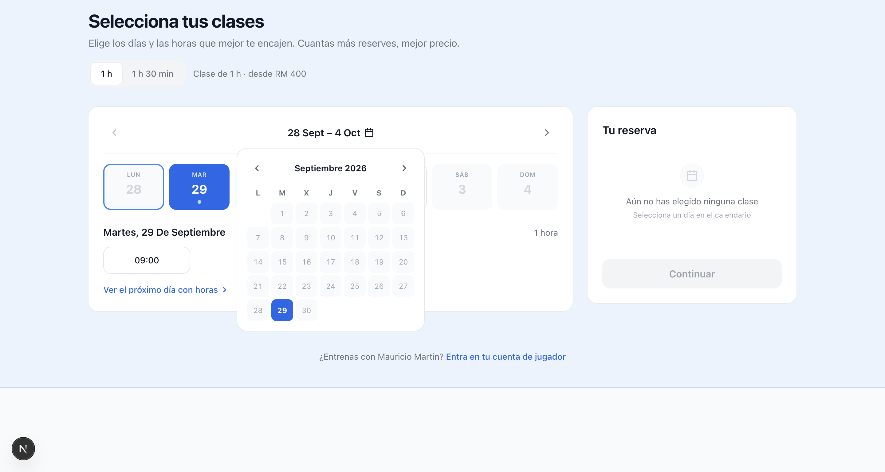

# Tarjetas

Abre este archivo en Nimbalyst para ver las capturas y las decisiones de cada cambio. En el tablero, selecciona **All** para incluir las tareas hechas.

- Mauri · H2 — Investigar la reserva completa #tarjeta[id:tar_01M3Q7D4K2F9AX6RB5T8V0C1ZE status:en-desarrollo priority:high created:2026-09-29 tags:mauri,h2,investigacion linea:mauri hito:h2]
  Resultado esperado: saber qué ve el jugador desde elegir hora hasta recibir confirmación, y qué necesita Mauri para gestionarla.
  - Lectura del código en `develop` (29/09, aún sin prueba visual local): selección de sesiones → checkout con datos de jugador o invitado → POST de solicitud → pantalla «Booking request received», pendiente de que Mauri confirme la pista. [BookingFlow](../../components/booking/BookingFlow.tsx) · [Checkout](../../components/booking/checkout/BookingCheckout.tsx).
  - Diferencia a resolver: el plan maestro pide cuenta obligatoria, pero `BookingCheckout` y `POST /api/reservations` todavía permiten invitados. La guía `docs/BOOKING_FLOW.md` también describe componentes antiguos: contrastarla con el código antes de usarla para implementar.
  - Referencias documentales consultadas el 29/09: [Calendly: página de confirmación](https://calendly.com/help/how-to-add-links-to-the-event-confirmation-page) y [Acuity: página de confirmación y gestión](https://help.acuityscheduling.com/hc/en-us/articles/16676898629133-Customize-the-confirmation-page). Son documentación oficial, no recorridos de reserva probados; falta hacer la comparación visual.
  - Primero recorrer nuestra versión de `develop` en escritorio y móvil, sin efectuar un cobro ni enviar una reserva real. Señalar pasos confusos, mensajes y límites de la prueba.
  - Después comparar hasta dos servicios de reservas relevantes, con enlace, fecha, recorrido y lo que no se pueda comprobar. Guardar capturas sin datos privados.
  - Enseñar a Dani un esquema breve de antes/después y una propuesta. Las reglas de cobro, cancelación y confirmación pasan a «Por decidir» antes de programarlas.
  - [Cómo investigar y desarrollar](../../docs/CONTROL_DEL_PROYECTO.md) · [Plan de Mauri](../../docs/PLAN_MAESTRO_PRODUCTO_Y_ENTREGA.md).

- Mauri · H2 — Encontrar y reservar una hora fácilmente #tarjeta[id:tar_01M3M7C2XFWRBJDKTNF0QW03CR status:hecha priority:high created:2026-09-28 tags:mauri,h2,ux linea:mauri hito:h2]
  Resultado: semana compacta, horas visibles y minicalendario centrado.
  **📸 MIRA EL CAMBIO:** [Antes en escritorio](https://github.com/danielruizpadel-ux/trainer-booking-platform/blob/develop/docs/evidencias/mauri-reserva-facil/antes-desktop.png) → [Después en escritorio](../../docs/evidencias/mauri-reserva-facil/v3-desktop-minical-centrado.png) · [Después en móvil](https://github.com/danielruizpadel-ux/trainer-booking-platform/blob/develop/docs/evidencias/mauri-reserva-facil/v3-mobile-minical-centrado.png)
  
  [Todas las capturas, decisiones y pruebas](https://github.com/danielruizpadel-ux/trainer-booking-platform/blob/develop/docs/evidencias/mauri-reserva-facil/RESUMEN.md) · [Cambio revisado: PR #5](https://github.com/danielruizpadel-ux/trainer-booking-platform/pull/5).
  - Dani aprobó la pantalla; Codex corrigió la navegación semanal. Integrado en `develop`. Todavía no se ha publicado ni se ha realizado una reserva real.

- Proceso · H0 — Probar protocolo de trabajo #tarjeta[id:tar_01M3KB7Y8AYB5X5TPVS7V9G73E status:hecha priority:medium created:2026-09-28 tags:proceso,h0 linea:proceso hito:h0]
  Resultado: tareas, decisiones y evidencias recuperables desde GitHub.
  - Comprobado: el tablero y las tarjetas aparecen en una copia limpia de `develop`. Las tareas hechas se ven con el filtro «All»; los enlaces se abren desde el editor de este archivo.
  - Confirmado por Dani el 29/09: al abrir este archivo actualizado en Nimbalyst, la captura de Mauri aparece al principio y se ve la vista previa.
  - Confirmado por Dani: una copia limpia de `develop` se actualizó hasta `f031b25` y mostró la nota nueva «Confirmado por Dani el 29/09»; no quedaron cambios locales.
  - Límite: la sincronización requiere actualizar Git; no se ha probado edición simultánea ni se ha adoptado Nimbalyst como interfaz única.
  - [Plan del proyecto](../../docs/PLAN_MAESTRO_PRODUCTO_Y_ENTREGA.md) · [Protocolo de trabajo](../../AI_WORKFLOW.md).
